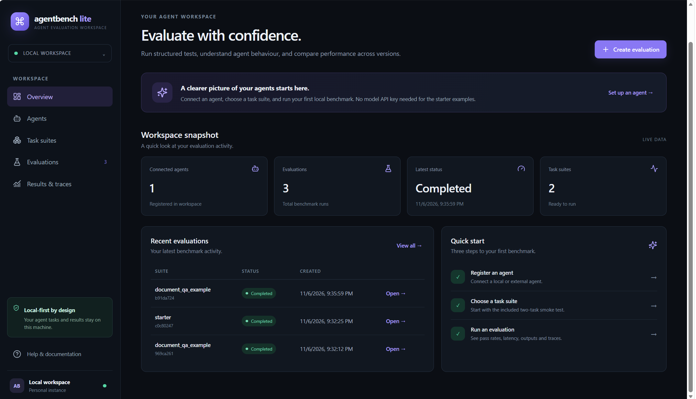
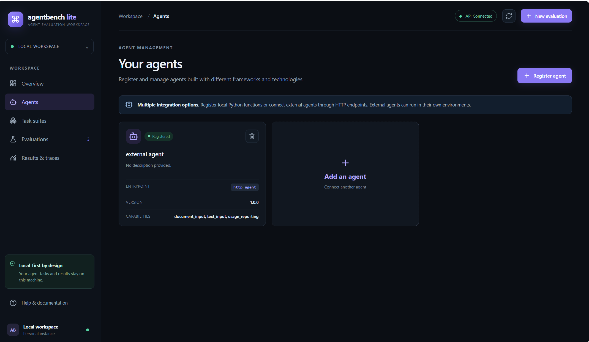
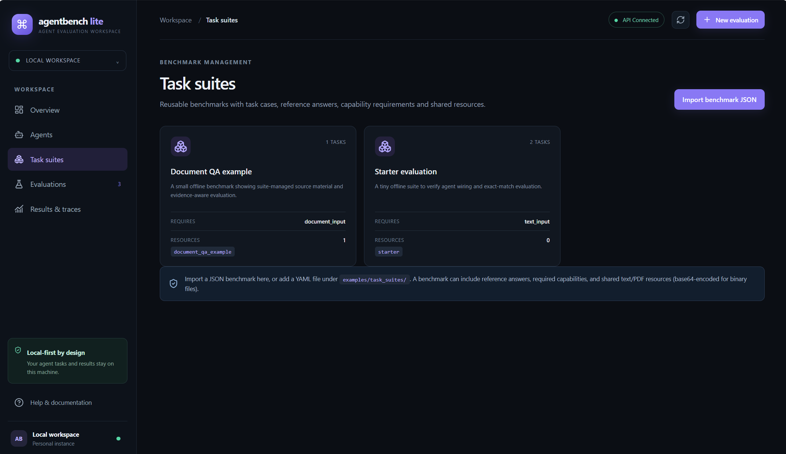
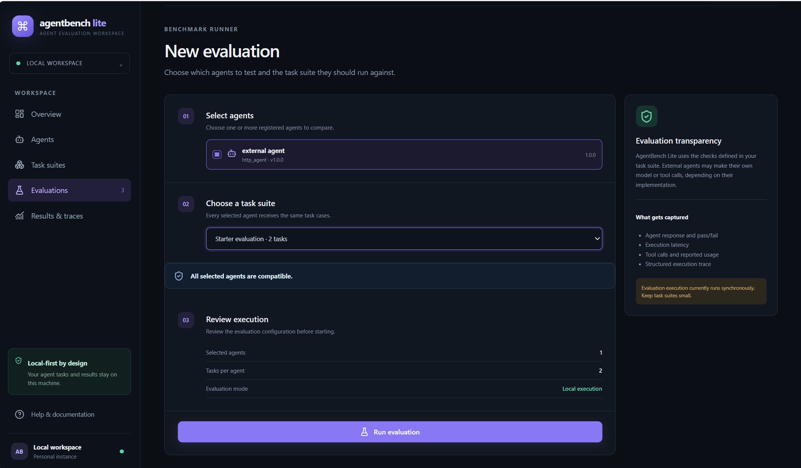
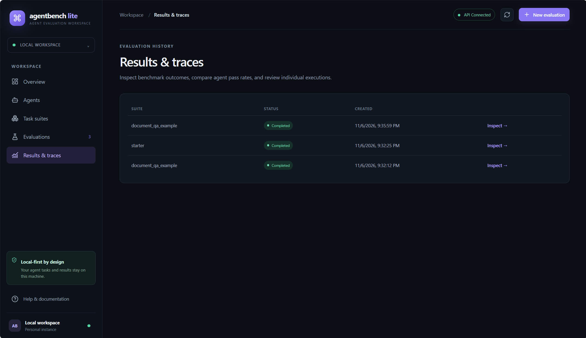

# AgentBench Lite
### A Local-First Platform for Evaluating and Comparing AI Agents

AgentBench Lite is a framework-independent AI agent evaluation platform that enables developers to connect, benchmark, evaluate, and compare external AI agents through a standardized HTTP interface.

It provides a centralized workspace for managing agents, configuring benchmark suites, executing evaluation tasks, analyzing results, and inspecting execution traces — while allowing agents to run independently in their own environments.

## Key Features

- **Agent Registration & Discovery:** Connect external AI agents through HTTP endpoints, discover capabilities through optional manifest endpoints, and configure agents manually when discovery is unavailable.
- **Connection & Health Checks:** Verify agent connectivity using health and manifest endpoints without invoking task execution or consuming LLM tokens.
- **Framework Independence:** Support agents built with LangChain, CrewAI, AutoGen, custom Python applications, or other frameworks through a standardized HTTP protocol.
- **Configurable Benchmark Suites:** Create and import JSON or YAML benchmark suites with reference answers, task metadata, evaluation criteria, and shared resources.
- **Automated Evaluation:** Assess agent responses using deterministic checks, including exact matching, keyword matching, JSON validation, source metadata, and tool-call verification.
- **Weighted Scoring:** Apply configurable evaluation weights to measure agent performance against benchmark criteria.
- **Execution Traces:** Inspect structured execution details, evaluator diagnostics, tool-call metadata, and agent responses.
- **Result Tracking:** Store agent configurations, benchmark executions, evaluation details, and historical results using SQLite.
- **Resource-Based Evaluation:** Supply text and binary resources to agents for document-oriented and other resource-dependent tasks.

## How It Works

AgentBench Lite acts as the evaluation layer between benchmark tasks and independently running AI agents.

1. **Register an Agent:** Connect an external agent through its HTTP endpoint.
2. **Discover Capabilities:** Retrieve its optional manifest and verify connectivity.
3. **Configure Benchmarks:** Create or import benchmark suites containing tasks, reference answers, evaluation criteria, and resources.
4. **Execute Tasks:** Dispatch benchmark inputs and resources to the selected agent.
5. **Evaluate Responses:** Run configured evaluation checks and calculate weighted scores.
6. **Analyze Results:** Review evaluation outcomes, diagnostics, execution traces, and historical results.

## Architecture

```text
          AgentBench Lite
                 |
       +---------+----------+
       |                    |
   Agent Manager       Benchmark Manager
       |                    |
       +---------+----------+
                 |
          Evaluation Engine
                 |
       +---------+----------+
       |                    |
   HTTP Dispatcher     Evaluator
       |                    |
       v                    v
 External AI Agents    Scoring & Results
       |
   Agent Endpoints
       |
  /health /manifest /agent

          SQLite Storage
                 |
       Agents, Suites, Runs,
       Results and Traces
```

## Technology Stack

| Component | Technologies |
|---|---|
| Backend | Python, FastAPI |
| Frontend | React, TypeScript |
| API Communication | REST APIs, HTTP |
| Data Validation | Pydantic |
| Benchmark Configuration | YAML, JSON |
| Database | SQLite |
| Testing | Pytest |
| Development Tools | Git, GitHub, VS Code |

## Agent Integration

AgentBench Lite supports external agents through a generic HTTP protocol.

An agent can expose the following endpoints:

| Endpoint | Purpose |
|---|---|
| `GET /health` | Check agent availability |
| `GET /manifest` | Discover supported capabilities |
| `POST /agent` | Submit benchmark tasks for execution |

Manifest discovery is optional. Agents without a manifest can be registered using manually declared capabilities.

The connection-testing workflow verifies endpoint availability without invoking the agent's task endpoint or making hosted LLM calls.

An example HTTP agent implementation is available in `examples/http_agent_example.py`.

## Benchmarking & Evaluation

Benchmark suites can be configured using YAML or JSON.

Supported evaluation checks include:

- `not_empty` – Verify that the response is not empty.
- `exact_match` – Compare the response against an expected answer.
- `contains` – Check whether the response contains specified content.
- `starts_with` – Validate the beginning of a response.
- `json_valid` – Verify JSON response validity.
- `tool_called` – Check reported tool-call metadata.
- `has_sources` – Check whether source metadata is provided.
- `usage_reported` – Verify whether usage telemetry is returned.

Evaluation diagnostics include pass/fail status, scores, weights, reasons, and evaluator errors.

AgentBench Lite uses deterministic evaluation checks by default. It does not automatically invoke an LLM judge.

## Benchmark Resources

Benchmark suites support shared text and binary resources.

Each resource can contain:
- Resource ID and name
- MIME type
- Text content or Base64-encoded binary content

Tasks reference resources through `resource_ids`.

Resource-dependent suites can declare the `document_input` capability as a requirement.

Example resources and benchmark configurations are available in:

- `examples/task_suites/document_qa_example.yaml`
- `docs/agent-protocol-v1.md`

## Getting Started

### Prerequisites

- Python installed
- Node.js and npm installed
- Git installed

### 1. Clone the Repository

```bash
git clone https://github.com/rakshithanevuri/AgentBench-Lite.git
cd AgentBench-Lite
```

### 2. Set Up the Backend

```powershell
python -m venv .venv
.venv\Scripts\Activate.ps1
pip install -e ".[dev]"
```

### 3. Run Tests

```bash
pytest -q
```

### 4. Start the Backend

```bash
uvicorn agentbench_lite.api:app --reload
```

The backend will be available at:

`http://127.0.0.1:8000`

### 5. Start the Frontend

Open another terminal:

```powershell
cd frontend
npm install
npm run dev
```

Open the Vite development URL printed in the terminal, normally:

`http://127.0.0.1:5173`

## Example Use Cases

- Compare responses from multiple AI agents against the same benchmark.
- Evaluate agents built using different frameworks through a common interface.
- Test document question-answering agents using shared benchmark resources.
- Inspect agent responses, reported tool calls, and evaluation diagnostics.
- Track benchmark execution results and compare agent performance.

## Project Structure

```text
AgentBench-Lite/
├── agentbench_lite/
│   ├── api.py
│   └── ...
├── frontend/
├── examples/
│   ├── http_agent_example.py
│   └── task_suites/
├── docs/
│   └── agent-protocol-v1.md
├── tests/
├── .gitignore
└── pyproject.toml
```

*The structure above illustrates the main project areas; individual files may vary.*

## Current Limitations

- Designed as a local-first, single-user workbench.
- External HTTP agent endpoints are restricted to localhost/loopback addresses.
- Evaluation is synchronous and subject to the configured maximum tasks per run.
- Binary resources are transported using Base64 encoding, with a 5 MB resource limit.
- Agent-reported sources, tool calls, and token usage are telemetry, not independently verified evidence.
- No built-in LLM-as-a-judge, remote endpoint authentication, streaming, or conversation-state orchestration.

## Security Considerations

The current implementation restricts HTTP agent connections to loopback addresses. Remote endpoint support requires additional authentication, authorization, and server-side request forgery (SSRF) protections.

Do not commit API keys, credentials, private datasets, or environment files to the repository.

## Future Scope

Potential improvements include:
- Secure remote agent connectivity and authentication.
- Asynchronous benchmark execution.
- Advanced agent comparison and analytics.
- Additional evaluation strategies and configurable evaluators.
- Improved benchmark reporting and export capabilities.

## Author

**Rakshitha Nevuri**

AI/ML & Data Science Enthusiast

- GitHub: https://github.com/rakshithanevuri
- LinkedIn: https://www.linkedin.com/in/rakshithanevuri/

## Screenshots

### Dashboard


### Agent Management


### Task Suites


### Evaluation


### Results


---

*AgentBench Lite is an independent project focused on making AI agent evaluation more structured, transparent, and accessible.*